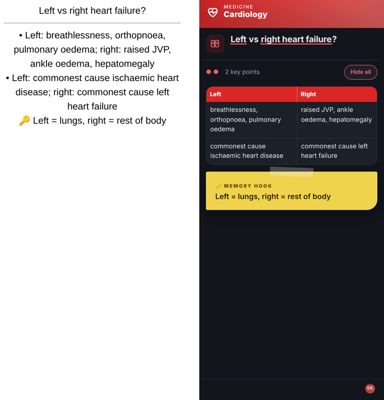
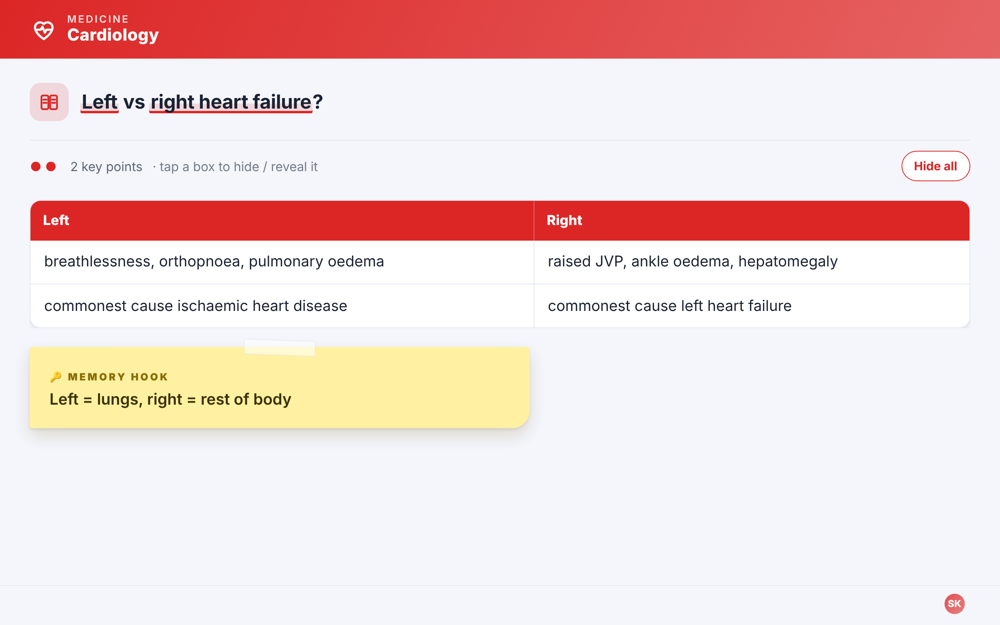
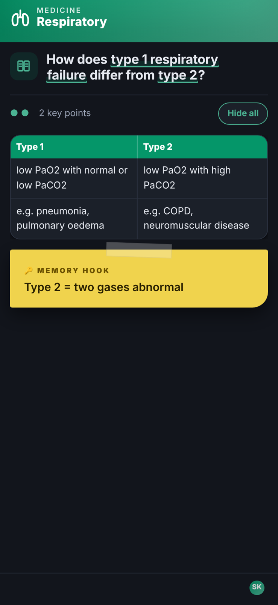
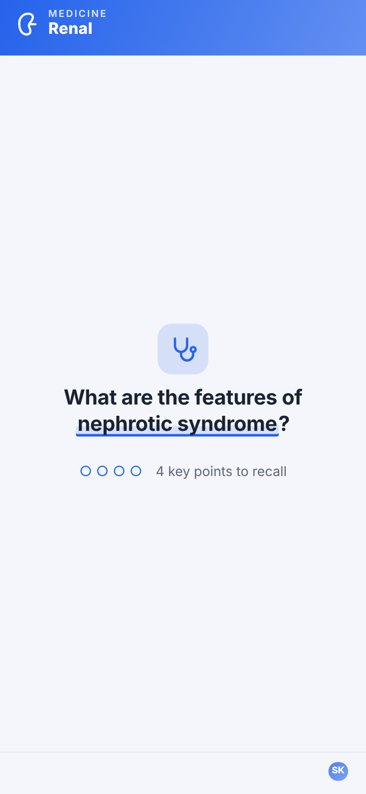

# Anki SK Studio

**Turn your notes and past papers into exam-focused Anki cards, and make any Anki deck look like this:**



Two [Claude](https://claude.ai) skills, made by a medical student who would rather study from flashcards than read a book page by page:

| Skill | What it does |
|---|---|
| **SK Designer** (`anki-sk-designer`) | Restyles **any** Anki deck: a coloured band for each subject, the topic highlighted, numbered boxes you tap to hide and reveal (self-test), automatic **comparison tables**, blue **formula boxes**, a yellow **memory-hook** sticky note, a tap-to-zoom picture frame, and full **dark mode**. Works in Anki desktop, AnkiDroid and AnkiMobile. **Your wording and your review progress are kept.** |
| **SK Card Builder** (`anki-sk-cardbuilder`) | Builds cards from **your own material**: past papers, syllabus, slides, notes, even a shared Google Drive folder. It ranks topics by how often they're asked, writes lean cards (1–5 points, a hook), checks for gaps, duplicates and errors against your slides, shows you a **preview to approve**, and gives you one tested file to import. |

<p>



</p>

## Install
Pick the one that matches how you use Claude:

**1. Claude Code on the web or phone (claude.ai/code):** start a new session and **select this repository** (`samaha-k/anki-sk-studio`). The skills in `.claude/skills/` load automatically. Then attach your deck or notes and ask.

**2. Claude Code on a computer (desktop app or terminal):**
```
/plugin marketplace add samaha-k/anki-sk-studio
/plugin install anki-sk-studio@anki-sk-studio
```

**3. Claude.ai chat:** download the two zips in [`dist/`](dist) and upload them in **Settings → Capabilities → Skills** (code execution must be on).

*Tested in Claude Code so far. Please open an issue if something fails.*

## Use it
Just ask Claude, for example:
- *"Make my Anki deck look nicer"* (attach your deck: in Anki, right-click it → Export → **Anki Deck Package (.apkg)**, with **Include media** and **Include scheduling** ticked)
- *"Make Anki cards for my pathology exam from these past papers and slides"*
- *"Here's my Drive folder with notes and past papers; build cards for ENT"* (the folder must be shared as "Anyone with the link")

Then import the file Claude gives you: **File → Import** in Anki desktop (tick **Import any learning progress**), then sync.

Try it first with the sample deck in [`examples/`](examples): `sample_plain.apkg` (before) and `sample_SK.apkg` (after).

## What the cards show
| Badge | Meaning |
|---|---|
| 🎓 University Q | asked in a past university paper |
| ⚡ High-yield | important, not asked yet |
| 🔥 Exam favourite | asked in this year's term exams |
| ✦ Bonus | from the textbook, not your own notes |

Filter in Anki with the tags `has_image` and `has_formula`.

## Run the scripts yourself (optional)
```bash
pip install anki playwright python-pptx python-docx && playwright install chromium
# optional, for reading scanned PDFs: poppler-utils and tesseract-ocr
python3 skills/anki-sk-designer/scripts/design.py my_deck.apkg my_deck_SK.apkg --label "Pathology"
python3 skills/anki-sk-designer/scripts/verify.py my_deck.apkg my_deck_SK.apkg --tables
python3 skills/anki-sk-designer/scripts/preview.py my_deck_SK.apkg previews --phone --dark
```
`verify.py` checks that every word and every card's progress is unchanged before you import.

## Please respect copyright
These skills work on **your own** material. Don't share your institution's slides, notes or past papers publicly, and don't upload other people's decks without permission.

## License
MIT, made by **SK**.
